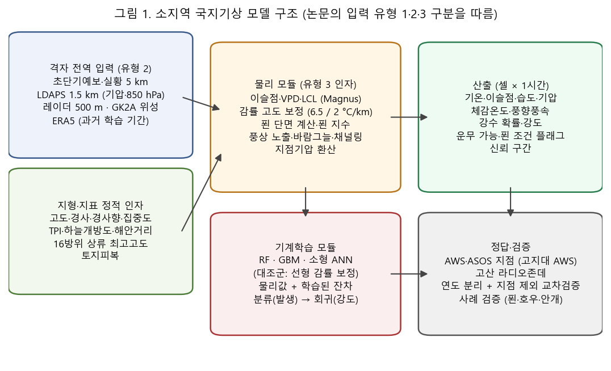
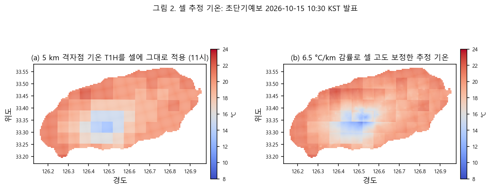
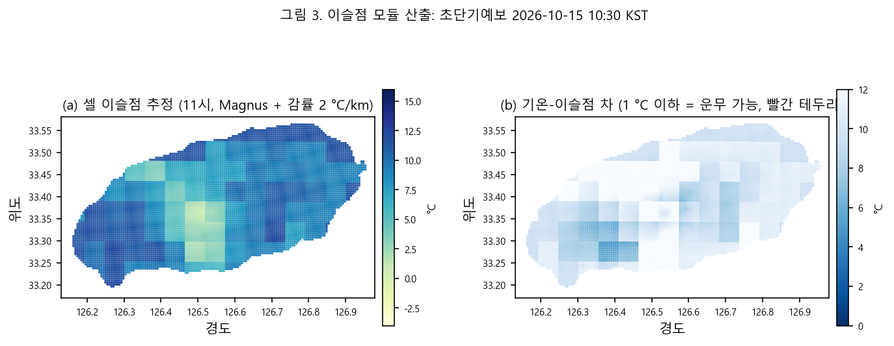
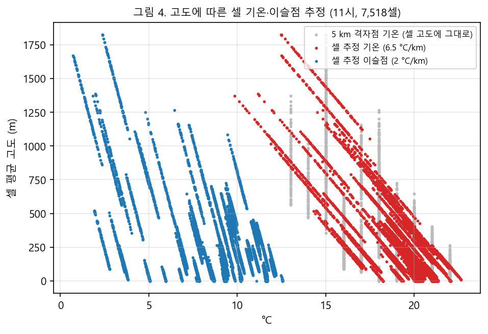
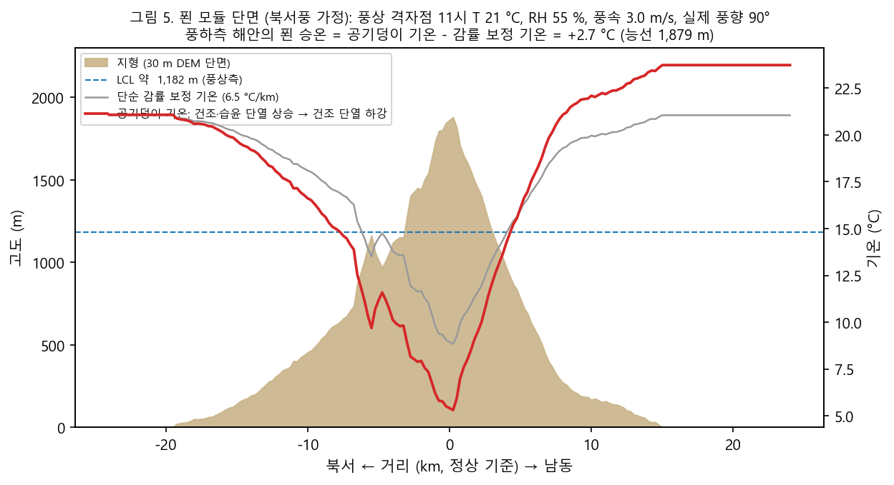
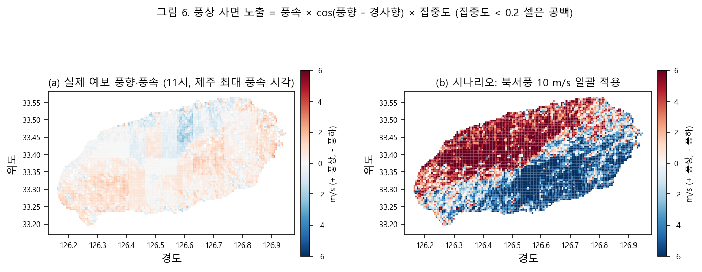
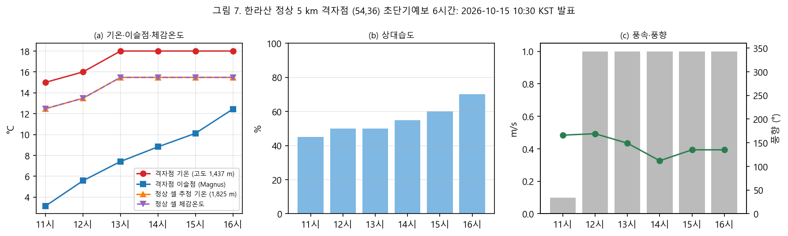
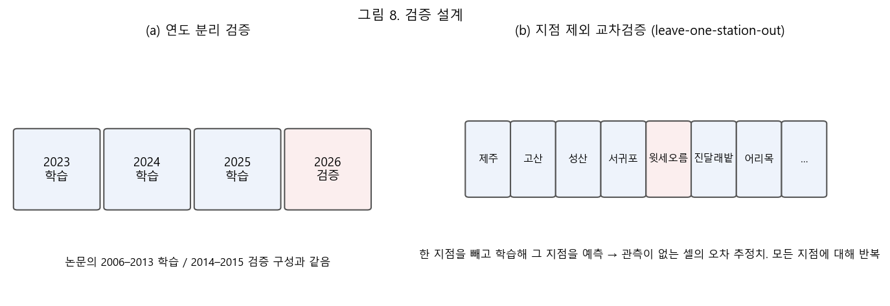

# 요약

이 보고서는 현재 운영 중인 제주 지형 라이브 지도(500 m 격자 7,518셀, 기상청 레이더·초단기예보 연동)를 바탕으로, **이슬점 온도와 푄(foehn) 현상을 중심으로 한 소지역 단위 국지기상 분석 모델**을 설계한 결과를 정리한 것이다. 설계의 틀은 참조 논문(이보라 외, 2019)의 방법론을 따른다. 논문은 플럭스 타워의 점 관측을 정답으로 두고, 지상 관측 입력과 위성 입력을 각각 기계학습 모델(SVM·RF·ANN)에 학습시켜 위성 입력만으로도 지상 관측 수준의 정확도(R = 0.93)에 도달할 수 있음을 보였다. 이 결과가 가능했던 핵심은 정답과 직접 대응하는 인자(개량식생지수)를 위성 입력에 추가한 데 있다. 본 설계에서는 그 역할을 **이슬점·상승응결고도(LCL)·푄 지수·풍상 사면 노출 같은 물리 유도 인자**가 맡는다.

모델은 세 층으로 구성한다. ① 격자 전역에서 얻을 수 있는 입력(초단기예보·실황, LDAPS 국지모델, 레이더, 천리안 위성, 지형), ② 이를 셀 단위 물리량으로 바꾸는 물리 모듈(이슬점·LCL·VPD, 감률 고도 보정, 푄 단면 계산, 지형 바람, 지점기압), ③ 물리값과 AWS 관측의 잔차를 학습하는 기계학습 모듈(RF·GBM·소형 ANN, 대조군은 선형 감률 보정)이다. 산출은 셀 × 1시간의 기온·이슬점·습도·기압·체감온도·풍향풍속·강수·운무 가능·푄 조건 플래그와 신뢰 구간이며, 대시보드의 색상 기준과 강조 레이어로 연결한다.

추가로 수집해야 할 자료는 세 묶음이다. 첫째, **정답 자료**인 AWS·ASOS 시·분 관측(특히 한라산 고지대 AWS)과 고산 라디오존데. 둘째, **격자 전역 입력**인 LDAPS 지상·등압면 자료, 초단기실황·단기예보, 천리안 2A 안개·구름 산출물, 레이더 반사도 구조, ERA5 재분석. 셋째, **지형 파생 인자**인 지형위치지수·하늘개방도·풍향별 상류 최고고도·해안 거리·토지피복이다. 정답 자료 없이는 학습과 검증이 불가능하므로 수집 1순위는 AWS·ASOS 과거 3년 이상의 자료이다.

본문에 실은 그림 2–7은 2026년 10월 15일 10시 30분 발표 초단기예보 한 회차를 설계된 물리 모듈에 통과시켜 얻은 **시연 산출**이다. 관측과 비교해 검증한 결과가 아니며, 모델이 무엇을 계산하고 어떤 모양의 출력이 나오는지를 보이기 위한 것이다.

# 1. 배경과 목적

## 1.1 배경

Halla-GeoData 저장소는 Copernicus GLO-30 지형자료로 만든 제주 전역 500 m 참고격자(기상청 레이더 합성 격자 정의와 일치)에 경사·고도 통계를 담고, 기상청 API허브의 레이더 누적강수(500 m, 5분)와 동네예보 초단기예보(5 km, 1시간)를 실시간으로 결합해 웹 대시보드로 제공한다. 2026년 10월 15일 기준으로 대시보드는 다음 격자 지표를 제공한다.

- 지형: 평균·최대 경사, 20° 이상 면적 비율, 평균·최고 고도, 경사향과 집중도
- 레이더: 강수 강도(mm/h), 3·6·24시간 누적, 급경사·강수 강조 셀
- 예보: 1시간 강수, 6시간 합계, 풍상 사면 노출, 셀 추정 기온, 기온−이슬점 차, 체감온도
- 보조 레이어: Sentinel-2 실색·NDVI·적설, 음영기복, OSM 대피소·화장실·주차장·안내소·AED, 등산로 난이도, 강수 이동 예상 화살표

이 지표들은 5 km 예보값을 셀 지형으로 단순 보정한 값이다. 한라산처럼 1,950 m 고도차가 수십 km 안에 있는 지역에서는 바람이 산을 넘을 때 생기는 푄 현상, 고도별 이슬점 변화에 따른 운무, 바람그늘과 바람맞이의 기온·습도 차이가 5 km 격자 평균값에 묻힌다. 탐방 안전(저체온·강풍·시정), 산불 위험(건조·강풍), 집중호우 대응(지형성 강수) 어느 쪽에서도 이 국지 효과가 핵심 변수이다.

## 1.2 목적

- 이슬점과 푄 현상을 물리적으로 계산하는 모듈을 설계하고, 그 산출을 셀 단위 국지기상(강우, 습도, 기압, 체감온도, 풍향 등)으로 확장하는 모델 구조를 정의한다.
- 참조 논문의 방법(점 관측 정답, 입력 유형 비교, 기계학습 대 선형 대조군, 연도 분리 검증)을 격자 기상 문제에 맞게 옮긴다.
- 현재 보유 자료와 대비해 추가로 수집해야 할 데이터를 출처·해상도·승인 상태까지 명시하고, 자료별 활용 방안을 시나리오 단위로 구체화한다.

# 2. 참조 논문 검토

## 2.1 논문 개요

이보라·장근창·김은숙·강민석·천정화·임종환(2019), "머신러닝 기법의 산림 총일차생산성 예측 모델 비교", 한국농림기상학회지 21(1), 29–41. 경기도 광릉 KoFlux 활엽수림 플럭스 타워(40 m)의 2006–2015년 에디공분산 자료와 MODIS 위성 산출물로 일 단위 총일차생산성(GPP)을 예측하는 모델을 만들고, 선형회귀(LM)와 세 기계학습 알고리즘(SVM, RF, ANN)을 비교했다.

## 2.2 방법의 요점

- **정답 자료**: 플럭스 타워의 30분 평균 관측을 KoFlux 표준 처리(좌표 회전, 밀도 보정, 결측 메우기 등)로 품질관리한 뒤 일 단위 GPP로 집계했다.
- **입력 유형 세 가지**: 유형 1은 타워 관측 기상인자(기온·습도·순복사·강수·증발산), 유형 2는 MODIS에서 산출한 같은 역할의 인자(기온·일사·수증기압포차 VPD), 유형 3은 유형 2에 MODIS에서만 얻는 개량식생지수(EVI)를 더한 것이다.
- **위성 기온의 고도 보정**: MODIS 대기 프로파일(MYD07, 5 km) 기온을 기온감률 방식으로 지표 고도에 맞춰 보정하고, 흐린 날의 결측은 픽셀별 회귀로 메워 연속 자료를 만들었다.
- **VPD 산출**: Dingman(2008)의 포화수증기압·현재수증기압 식으로 VPD를 계산했다.
- **일사량**: Bird 청천 모델에 MODIS 알베도(MCD43)를 적용했다.
- **학습·검증**: 2006–2013년으로 학습하고 2014–2015년으로 검증했으며, 상관계수 R, RMSE, MSE로 평가했다. R 패키지 e1071(SVM), randomForest, neuralnet을 사용했다.

## 2.3 결과의 요점

- 세 유형 모두에서 기계학습 모델이 선형 모델보다 유의하게 좋았다(R 0.85–0.93 대 0.82–0.92). 선형 모델은 개엽·낙엽기처럼 비선형으로 급변하는 구간을 따라가지 못했다.
- 위성 입력만 사용한 유형 2는 가장 성능이 낮았으나(R 0.82–0.86), EVI를 더한 유형 3은 타워 입력(유형 1)과 같거나 더 높은 성능(R 0.92–0.93)을 보였다.
- 알고리즘 간 차이는 매우 작았다. 입력 자료의 설계가 알고리즘 선택보다 결과를 좌우했다.

## 2.4 본 설계에 대한 시사점

1. **정답 자료의 품질이 모델의 상한을 정한다.** 플럭스 타워에 해당하는 것은 제주의 AWS·ASOS 지점이며, 특히 한라산 고지대 AWS가 핵심이다. 정답 자료 확보가 다른 어떤 작업보다 앞선다.
2. **격자 전역 입력만으로도 지점 관측 수준에 도달하려면 "정답과 직접 대응하는 인자"가 필요하다.** 국지기상에서 EVI의 자리에 오는 것은 이슬점·LCL·푄 지수·풍상 노출 같은 물리 유도 인자이다. 기계학습은 이 인자를 대체하지 않고 잔차를 메우는 역할을 한다.
3. **감률 고도 보정과 결측 보완 기법**을 그대로 쓴다. 5 km 예보값을 셀 고도로 보정하는 현재 방식이 논문의 MODIS 보정과 같은 자리이다.
4. **검증은 연도 분리 + 선형 대조군 + R·RMSE·MSE**를 기본으로 하되, 관측 없는 셀에서의 오차를 말하려면 지점 제외 교차검증이 추가로 필요하다.
5. **알고리즘보다 입력 설계에 투자한다.** RF를 기본으로 두고 GBM·ANN은 비교용으로만 운영한다.

# 3. 현재 시스템과 보유 자료

| 구분 | 보유 자료 | 비고 |
|---|---|---|
| 참고격자 | 제주 500 m 7,518셀, 한라산 1,849셀 (`inputs/reference/radar_grid_cells.gpkg`) | 기상청 레이더 합성 격자 정의(LCC 30/60, 126E/38N, WGS84 타원체)와 0.8 m 이내 일치 검증 |
| 지형 | GLO-30 DSM 30 m, 경사·경사향 래스터, 셀별 평균·90백분위·최대 경사, 고도, 경사향·집중도 | `outputs/jeju_slope/` |
| 레이더 | PCPH 60·180·360·1440분 누적 → mm/h 변환, 셀 집계 | API허브 승인, 실시간 수집 가능 |
| 예보 | 초단기예보 6시간(T1H·REH·VEC·WSD·RN1·PTY·SKY·UUU·VVV), 5 km 격자점 95개, 점 대표 고도 | DFS 좌표 변환은 공식 변환기로 매회 대조 |
| 위성 | Sentinel-2 L2A 합성(실색·NDVI·적설), 음영기복 | AWS Open Data, 40 m |
| 벡터 | 한라산 탐방로, 제주올레, 국립공원 경계, OSM POI·sac_scale | ODbL |
| 대시보드 | Leaflet 지도, 공유 DB 동기화, 독립 실행 HTML | 색상 기준 13개, 레이어 15개 |
| 미승인 | 기상특보, AWS 매분자료, ASOS 시간자료, 수치모델 | 활용신청 대기 또는 미신청 |

현 시스템에서 바로 쓸 수 있는 "격자 전역 입력"은 초단기예보·레이더·지형·Sentinel-2이고, "정답 자료"는 아직 없다. 이것이 추가 수집 목록의 출발점이다.

# 4. 모델 설계

## 4.1 설계 원칙과 구조

설계 원칙은 다음 다섯 가지이다.

1. **물리 먼저, 학습은 잔차**: 이슬점·푄·감률 보정처럼 식이 알려진 부분은 물리 모듈로 계산하고, 기계학습은 물리값과 관측의 차이(잔차)만 학습한다. 관측이 없는 셀에서도 물리값은 계산되고 잔차는 지형 인자로 일반화된다.
2. **입력 유형 분리**: 지점에서만 가능한 입력(유형 1)과 격자 전역에서 가능한 입력(유형 2·3)을 분리해 모델을 따로 만들고, 유형 1을 성능 상한의 기준으로 삼는다.
3. **대조군 유지**: 현재 대시보드의 선형 감률 보정값을 논문의 LM처럼 대조군으로 두고, 모든 개선을 이 값 대비로 보고한다.
4. **검증 가능한 단위로 산출**: 셀 × 1시간으로 산출하되, 지점이 있는 셀에서 관측과 바로 비교할 수 있게 한다.
5. **공식 예보의 보조**: 산출은 분석값이며 기상청 예보·특보를 대신하지 않는다는 표기를 모든 출력에 붙인다.

## 4.2 예측 목표 변수

| 목표 변수 | 정의와 산출 방법 | 정답 자료 |
|---|---|---|
| 셀 기온 T | 점 T1H − 6.5 °C/km × (셀 평균고도 − 점 대표 고도) + 학습 잔차 | AWS·ASOS 기온 |
| 이슬점 Td | Magnus 식으로 점 Td 산출 후 이슬점 감률(약 2 °C/km)로 셀 고도 보정 + 잔차 | AWS 기온·습도(이슬점 환산), ASOS 이슬점 |
| 상대습도 RH | 셀 T와 Td에서 재계산 | AWS 습도 |
| 지점기압 P | ASOS 해면기압 또는 LDAPS 지표기압을 정역학식으로 셀 고도로 환산 + 잔차 | ASOS·AWS 기압 |
| 체감온도 | 기상청 산식(겨울: 풍속 반영 wind chill, 여름: 습도 반영) | 계산값(검증은 T·RH·WSD로) |
| 풍향·풍속 | 점 바람에 풍상 노출·바람그늘·채널링 보정 + 잔차 | AWS 풍향·풍속 |
| 강수 발생·강도 | 레이더 강도 + 지형성 강화·푄 건조 효과, 발생 분류 후 강도 회귀 | 레이더, AWS 우량 |
| 운무 가능 | T − Td ≤ 1 °C 이고 셀 고도 ≥ LCL 고도 | 천리안 안개 산출물, 고지대 AWS 습도 100 % |
| 푄 조건 | 푄 지수 > 0, 풍속 ≥ 5 m/s, 풍하 측, 습도 급락 | 풍상·풍하 지점 쌍 관측 |

## 4.3 물리 모듈

### 4.3.1 이슬점 모듈

점(5 km 격자점)의 기온 T와 상대습도 RH에서 Magnus 식으로 이슬점을 구한다.

- γ = ln(RH/100) + a·T/(b + T), Td = b·γ/(a − γ), a = 17.62, b = 243.12 °C
- 셀 이슬점: Td_cell = Td − 0.002 × (셀 고도 − 점 고도)  (이슬점 감률 약 2 °C/km)
- 셀 기온: T_cell = T − 0.0065 × (셀 고도 − 점 고도)
- 상승응결고도: LCL 높이 ≈ 125 m × (T − Td), LCL 고도 = 점 고도 + LCL 높이
- 수증기압포차: VPD = e_s(T_cell) − e_s(Td_cell), e_s(x) = 6.112·exp(17.62x/(243.12 + x)) hPa

셀 고도가 LCL 고도 이상이면 구름 속에 있을 가능성이 크고, T_cell − Td_cell이 1 °C 이하면 운무 가능 셀로 본다. VPD는 건조·산불 인자이자 증발 냉각의 지표이다. 현재 대시보드는 이슬점을 고도에 따라 일정하게 두는 보수적 근사를 쓰는데, 설계안에서는 이슬점 감률을 적용해 고지대에서 운무를 과대평가하지 않도록 한다.

### 4.3.2 푄 모듈 (한라산 횡단 단열 계산)

푄은 습한 공기가 산을 넘으며 풍상측에서 비를 내리고 풍하측에서 건조·고온으로 내려오는 현상이다. 제주에서는 북서 계절풍 때 서귀포 쪽, 남동풍 때 제주시 쪽이 풍하측이 된다. 모듈은 다음 순서로 계산한다.

1. **풍하 판정**: 셀의 풍향(VEC)을 16방위로 나누고, 그 방향의 상류로 한라산 능선이 있는지 확인한다. 지형 파생 인자 "풍향별 상류 최고고도 H_up"을 미리 계산해 두고, H_up − 셀 고도 > 300 m이면 바람그늘 셀로 본다.
2. **상류 공기 상태**: LDAPS 925·850 hPa 또는 고산 라디오존데의 기온·이슬점·바람을 쓰고, 없으면 풍상측 해안 격자점(초단기예보)의 T·RH로 대신한다.
3. **단열 상승**: 상류 공기를 LCL까지 건조단열(9.8 °C/km)로, LCL부터 능선까지 습윤단열(약 6 °C/km, 기온에 따라 5–6.5)로 올린다.
4. **단열 하강**: 능선에서 셀 고도까지 건조단열로 내린다. 능선을 넘으며 응결한 수증기는 제거된 것으로 보아 풍하측 이슬점을 낮춘다.
5. **푄 지수**: 푄 지수 = T_foehn − T_lapse(단순 감률 보정값). 능선이 LCL보다 높을 때만 양수가 되며, 크기는 (9.8 − 습윤감률) × (능선 − LCL)이다. 풍속 ≥ 5 m/s, 바람그늘 셀, 풍하측 습도 급락(3시간에 20 %p 이상)을 보조 조건으로 둔다.

푄 지수는 두 가지로 쓴다. 풍하측 셀의 기온·습도 예측에 입력 인자로 넣고, 건조·강풍 산불 위험 셀 판정에 직접 사용한다. 풍상·풍하 지점 쌍(예: 북서풍 때 애월·한림 대 서귀포·남원)의 AWS 관측 차이가 푄 지수를 검증하는 정답이 된다.

### 4.3.3 지형 바람 모듈

- **풍상 사면 노출**(구현됨): 풍속 × cos(풍향 − 경사향) × 집중도. 양수는 바람맞이, 음수는 바람그늘. 집중도 0.2 미만의 평탄 셀은 제외한다.
- **바람그늘 깊이**: 풍향별 상류 최고고도와 셀 고도의 차. 깊을수록 풍속 감소와 푄 승온이 크다.
- **계곡 채널링**: 지형위치지수(TPI)가 음수이고 계곡 방향과 풍향이 정렬되면 풍속 증가·풍향 수렴 인자를 준다.
- **해풍·해무**: 해안 거리와 해수면 온도 차로 낮 시간 해풍 침투 깊이를 추정하고, 해무는 해안 셀의 이슬점 차와 결합한다.

### 4.3.4 기압과 체감온도

- **지점기압**: ASOS 해면기압 P0(또는 LDAPS 지표기압)에서 정역학식 P = P0·exp(−g·h/(R·T_v))로 셀 고도 h의 기압을 구한다. 기압 "변화"는 셀 간 차이보다 시간 변화가 의미가 크므로 3시간 기압 변화 경향을 별도 인자로 둔다.
- **체감온도**: 겨울형은 기상청·JAG/TI 식(T ≤ 10 °C, 풍속 ≥ 4.8 km/h), 여름형은 습도 반영 식을 쓰며 셀 기온·풍속·습도의 산출값을 입력으로 한다.

## 4.4 기계학습 모듈

- **표본 단위**: AWS·ASOS 지점이 속한 셀 × 1시간. 지점 수 약 30개 × 3년 × 8,760시간이면 약 80만 표본으로, 논문의 일 단위 표본(약 3,000)보다 훨씬 많아 RF·GBM 학습에 충분하다.
- **입력 세트**: 유형 1(지점 관측 + 지형), 유형 2(격자 전역 입력 + 지형), 유형 3(유형 2 + 물리 유도 인자). 유형 2와 3을 비교해 물리 인자의 기여를 정량화한다.
- **목표별 모델**: 기온·이슬점·기압·풍속은 회귀. 풍향은 사인·코사인 성분 회귀 후 합성. 강수와 안개는 발생(분류) 후 강도(회귀)의 2단 구성.
- **알고리즘**: 랜덤포레스트를 기본(논문에서 지상 입력 시 최상, 결측·이상치에 강함), 그래디언트 부스팅과 소형 ANN을 비교군으로 둔다. 선형 감률 보정값을 대조군(LM)으로 보고한다.
- **잔차 학습**: 모델이 예측하는 값은 "물리값 + 잔차"이다. 물리값은 모든 셀에서 계산되고, 잔차는 지형 인자(고도·경사향·TPI·해안 거리·바람그늘 깊이)로 일반화되므로 관측이 없는 셀에서도 적용할 수 있다.
- **해석**: RF 변수중요도와 부분 의존도(partial dependence)로 푄 지수·LCL·풍상 노출의 기여를 확인하고, 기여가 없는 모듈은 단순화한다.

## 4.5 검증 설계

- **연도 분리**: 예컨대 2023–2025년 학습, 2026년 검증. 지표는 R, RMSE, MSE, 편향(bias).
- **지점 제외 교차검증**: 모든 지점에 대해 반복해 지점별 RMSE 지도를 만든다. 고지대 AWS를 제외했을 때의 오차가 설계의 실제 성능이다.
- **사례 검증**: 푄 사례일(풍상·풍하 기온차 ≥ 3 °C), 호우일(3시간 60 mm 이상), 안개일(천리안 안개 산출 또는 고지대 습도 100 %)을 골라 별도로 평가한다.
- **대조군 대비 개선율**: 모든 결과를 선형 감률 보정값의 RMSE 대비 감소율로도 보고한다.

## 4.6 산출과 대시보드 연계

- 셀 × 시각 산출을 공유 DB 문서(`radar/model`)와 정적 JSON으로 내보낸다. 필드: T, Td, RH, P, 체감온도, 풍향·풍속, 강수 확률·강도, 운무 가능, 푄 조건, 신뢰 구간.
- 대시보드 색상 기준에 이슬점, 지점기압, 푄 지수, 예측 습도를 추가하고, 강조 레이어로 "푄 건조·강풍", "운무 가능", "지형성 강수 강화"를 둔다.
- 실시간 갱신은 매시 초단기예보·레이더 수신 직후, 재학습은 월 1회 또는 AWS 자료 갱신 시.

# 5. 추가 수집 데이터

상태 표기: ● 보유, ◐ 일부 보유, ○ 미수집. 승인은 기상청 API허브 활용신청 기준이다.

## 5.1 정답(학습 목표) 자료 — 최우선

| 자료 | 용도 | 출처 / 경로 | 해상도 | 상태 |
|---|---|---|---|---|
| AWS 분·시 자료 (기온·습도·풍향·풍속·강수·기압) | 셀 단위 정답, 푄 사례 식별 | API허브 AWS 매분자료(`nph-aws2_min`), 시간자료; 과거 대량은 기상자료개방포털(data.kma.go.kr) CSV | 제주 지점 약 30개, 1분/1시간 | ○ (403, 활용신청 필요) |
| ASOS 시간자료 (제주 184, 고산 185, 성산 188, 서귀포 189) | 해면기압·이슬점·일사·운량 정답 | API허브 지상관측(`kma_sfctm2/3`), 포털 | 1시간 | ○ |
| 한라산 고지대 AWS 메타(지점번호·고도·좌표) | 고도 보정 검증, 교차검증 설계 | 포털 지점정보 | 1회 | ○ |
| 고산 라디오존데(47185) | 상류 연직 기온·이슬점·바람 → 푄 판정 참값, LCL 검증 | API허브 고층관측, 포털 | 00·12 UTC | ○ |
| 윈드프로파일러·라디오미터(제주 설치분) | 산악 상공 바람·수증기 연직 구조 | API허브 고층 | 10분 | ○ (설치 여부 확인) |
| 과거 특보 이력(강풍·호우·건조·대설·안개) | 사례 라벨, 분류 검증 | 특보 API(승인 대기), 포털 특보 이력 | 사건 단위 | ○ |

## 5.2 격자 전역 입력 (유형 2)

| 자료 | 용도 | 출처 / 경로 | 해상도 | 상태 |
|---|---|---|---|---|
| 초단기예보·실황 (T1H, REH, VEC, WSD, RN1, PTY, SKY, UUU, VVV) | 기본 기상 입력 | API허브 `getUltraSrtFcst` / `getUltraSrtNcst` | 5 km, 1시간 | ● 예보 / ○ 실황 |
| 단기예보 3일 (TMP, REH, VEC, WSD, PCP, POP, SNO) | 선행 시간 확장 | `getVilageFcst` | 5 km, 3시간 | ○ (승인됨, 미구현) |
| LDAPS 국지모델 지상·등압면 (T, Td, U/V, PS, PRMSL, 850/925 hPa) | 기압, 상류 공기 상태 → 푄 물리 인자 | API허브 수치모델(활용신청), 포털 | 1.5 km, 1시간 | ○ |
| 레이더 PCPH 60/180/360/1440분 | 실측 강수, 강수 이동 | `nph-rdr_cmp1_api` | 500 m, 5분 | ● |
| 레이더 반사도·에코 상단(ETOP)·강우강도 | 강수 구조, 지형성 강수 식별 | 같은 계열 | 500 m | ○ |
| 천리안 2A(GK2A) L2: 안개, 구름탐지·운정고도, 지표면온도, 강우강도, 가강수량 | 운무·구름 보조 정답, 위성 기온 | 국가기상위성센터(nmsc.kma.go.kr) API | 2 km, 10분 | ○ |
| 낙뢰 | 대류 사례 라벨 | API허브 낙뢰 | 점 | ○ |
| MODIS MOD07(기온·이슬점 프로파일), MOD11 LST, MCD43 알베도 | 논문과 같은 계열의 위성 기온·수증기, Bird 모델 일사량 | NASA LAADS / Earthdata(계정) | 1–5 km, 일 | ○ |
| Sentinel-3 SLSTR LST, Sentinel-2 NDVI·적설 | 지표 상태 인자 | Copernicus Data Space, AWS Open Data | 1 km / 10–40 m | ◐ (S2 보유) |
| ERA5·ERA5-Land 재분석 (2 m T/Td, 10 m 바람, 지표기압, 850 hPa) | 과거 학습 기간 연속 격자 입력, 결측 보완, LDAPS 대체 | Copernicus CDS(계정) | 9–31 km, 1시간 | ○ |

## 5.3 지형·지표 정적 인자 (유형 3의 재료)

| 자료 | 용도 | 출처 | 상태 |
|---|---|---|---|
| 셀 평균고도·경사·경사향·집중도 | 감률 보정, 풍상 노출 | GLO-30, `grid.geojson` | ● |
| 지형위치지수(TPI), 하늘개방도(SVF), 곡률 | 냉기 고임·야간 복사냉각·안개 | GLO-30에서 계산 | ○ |
| 풍향별(16방위) 상류 최고고도·거리 | 푄 지수, 바람그늘 깊이 | GLO-30에서 계산 | ○ |
| 해안선 거리, 해발 500 m 이하 평탄 여부 | 해풍·해무 | Natural Earth / OSM 해안선 | ○ |
| 토지피복도(환경부), 임상도(산림청) | 지표 거칠기·열 특성 | 환경공간정보서비스, 산림공간정보 | ○ |
| 국가지점번호, 탐방로 구간 | 결과 해석 단위 | 보유 탐방로·올레 | ● |

## 5.4 수집 우선순위와 대체 경로

1. **AWS·ASOS 과거 3년 이상**: 정답 없이는 학습·검증이 불가능하다. API 승인 전에는 기상자료개방포털에서 CSV로 내려받아 시작한다.
2. **LDAPS 지상·등압면**: 푄 모듈의 입력. 승인 전에는 ERA5로 설계를 먼저 검증한다.
3. **고산 라디오존데**: 푄 판정의 참값. 포털에서 과거 자료를 받을 수 있다.
4. **초단기실황·단기예보 수집기**: 현재 예보 수집기를 복제해 바로 구현 가능하다.
5. **지형 파생 인자**: 1회 계산으로 끝나며 외부 승인이 필요 없다.
6. **천리안 안개·구름, 레이더 반사도 구조**: 운무·지형성 강수 검증용으로 후순위.

# 6. 데이터 활용 방안 구체화

## 6.1 시나리오별 활용

| 시나리오 | 사용 자료 | 물리 인자 | 학습 목표 | 대시보드 표현 |
|---|---|---|---|---|
| 푄 건조·강풍 (산불·강풍 주의) | 초단기예보 풍향풍속·습도, LDAPS 850 hPa, 라디오존데, 풍향별 상류 최고고도 | 푄 지수, 바람그늘 깊이, VPD | 풍하측 기온·습도 잔차, 풍속 | 강조 레이어 "푄 조건", 색상 기준 "푄 지수" |
| 운무·시정 (탐방 안전) | 초단기예보 T·RH, 천리안 안개, 고지대 AWS 습도 | 이슬점 감률, LCL 고도, 기온−이슬점 차 | 운무 발생 분류 | 강조 레이어 "운무 가능", 색상 기준 "기온−이슬점 차" |
| 지형성 강수 강화 (호우 대응) | 레이더 누적·반사도, 풍상 노출, 850 hPa 바람·습도 | 풍상 노출 × 수증기 플럭스 | 셀 강수 강도 잔차 | 기존 급경사·강수 강조 셀에 풍상 가중 |
| 체감온도·저체온 (정상부) | 셀 기온·풍속·습도 산출 | 감률 보정, wind chill | 기온·풍속 잔차 | 색상 기준 "체감온도"(구현됨) |
| 기압 변화 (기상 악화 조짐) | ASOS 해면기압, LDAPS 지표기압 | 정역학 환산, 3시간 기압 경향 | 지점기압 잔차 | 색상 기준 "지점기압", 카드에 3시간 경향 |
| 강수 이동 (단기 대응) | 레이더 강수, 풍향풍속 | 1시간 이류 변위 | (물리값만) | 화살표 레이어(구현됨) |

## 6.2 자료별 처리 규칙

- **AWS·ASOS**: 1분 자료는 10분 이동평균 후 정시 값으로 집계한다. 결측·이상치는 논문의 KoFlux 처리처럼 범위 검사(기온 −30~45 °C, 습도 0–100 %)와 시간 연속성 검사로 제거하고 메우지 않는다(학습 표본에서 제외).
- **초단기예보·실황**: 발표 시각 기준으로 "선행 시간 0–6시간"을 구분해 저장한다. 실황(0시간)은 정답 보조로, 예보(1–6시간)는 입력으로 쓴다.
- **LDAPS·ERA5**: 850·925 hPa 기온·이슬점·바람을 격자점에 보간하고, 풍상측 대표 지점(풍향별 4개) 값을 셀마다 지정한다.
- **레이더**: 현재 변환기(PCPH → mm/h)를 그대로 쓰고, 반사도는 셀 최대·평균으로 집계한다.
- **천리안**: 안개·구름 산출물을 셀에 최근접 매핑하고, 운무 발생 라벨은 "천리안 안개 또는 고지대 AWS 습도 ≥ 98 %"로 정의한다.
- **지형 파생 인자**: GLO-30에서 QGIS로 TPI(반경 1 km), SVF, 16방위 상류 최고고도(반경 25 km)를 계산해 `grid.geojson`에 추가한다.

## 6.3 모델 운영 규칙

- 입력 중 하나라도 결측이면 물리값만 출력하고 잔차 보정은 생략하며, 출력에 "보정 없음" 플래그를 붙인다.
- 신뢰 구간은 지점 제외 교차검증의 지점별 RMSE를 지형 유사도로 보간해 셀마다 붙인다.
- 모든 산출에 발표 시각·선행 시간·모델 버전을 기록한다.

# 7. 단계별 추진 일정과 산출물

| 단계 | 내용 | 선행 조건 | 산출물 |
|---|---|---|---|
| 1 | AWS·ASOS 과거 자료 확보, 지점 메타 정리, 지형 파생 인자 계산 | 포털 다운로드 | 지점 DB, `grid.geojson` 확장 |
| 2 | 이슬점·LCL·푄 모듈 구현(초단기예보 + ERA5), 대시보드에 이슬점·푄 지수 표시 | 없음 | 물리 모듈 코드, 대시보드 색상 기준 2개 |
| 3 | 지점 기준 검증: 물리값 대 AWS, 선형 감률 보정 대조군 대비 개선 여부 | 1, 2 | 검증 보고서 1차 |
| 4 | LDAPS 연결, RF·GBM 학습, 지점 제외 교차검증 | API 승인 | 학습 모델, 지점별 RMSE 지도 |
| 5 | 셀 전역 적용, 신뢰 구간 표시, 사례 검증(푄·호우·안개) | 4 | 운영 모델, 검증 보고서 2차 |

# 8. 한계와 유의사항

- 5 km 예보값을 500 m 셀에 적용하면 셀 경계에서 값이 계단식으로 바뀐다. 물리 모듈은 고도·경사향에 따른 차이만 복원하며, 5 km 안의 수평 변화는 복원하지 못한다.
- 초단기예보의 10 m 바람은 지형 가림을 반영하지 않는다. 바람그늘·채널링 보정은 경험식이며 AWS로 검증해야 한다.
- 푄 모듈은 한라산 단일 능선을 가정한다. 오름 군집 지역에서는 상류 최고고도 산정이 거칠고, 습윤감률을 상수로 두는 근사도 포함한다.
- 관측이 없는 셀의 오차는 지점 제외 교차검증 값으로만 말할 수 있으며, 고지대 지점이 적을수록 그 추정도 불확실하다.
- 본 보고서의 그림은 한 회차 예보의 시연 산출이며 검증 결과가 아니다. 모든 산출은 분석용이고 기상청 공식 예보·특보를 대신하지 않는다.

# 부록 A. 산식 정리

| 항목 | 식 |
|---|---|
| 이슬점 (Magnus) | γ = ln(RH/100) + 17.62·T/(243.12 + T), Td = 243.12·γ/(17.62 − γ) |
| 포화수증기압 | e_s(T) = 6.112·exp(17.62·T/(243.12 + T)) hPa |
| 수증기압포차 | VPD = e_s(T) − e_s(Td) |
| 상승응결고도 | LCL 높이 ≈ 125 m × (T − Td) |
| 셀 기온 | T_cell = T_pt − 0.0065 × (h_cell − h_pt) |
| 셀 이슬점 | Td_cell = Td_pt − 0.002 × (h_cell − h_pt) |
| 푄 승온 | ΔT = (Γ_d − Γ_m) × (h_ridge − h_LCL), Γ_d = 9.8 °C/km, Γ_m ≈ 6 °C/km, h_ridge > h_LCL일 때 |
| 지점기압 | P = P_0 · exp(−g·h/(R_d·T_v)), g = 9.81, R_d = 287 J/(kg·K) |
| 체감온도 (겨울) | T_wc = 13.12 + 0.6215·T − 11.37·V^0.16 + 0.3965·T·V^0.16, V km/h, T ≤ 10 °C, V ≥ 4.8 |
| 풍상 사면 노출 | E = WSD × cos(VEC − aspect) × asp_r, asp_r ≥ 0.2 |
| 강수 이동 변위 | d = WSD × 3600 m, 방향 = VEC + 180° |

# 부록 B. 그림 재현 방법

그림 1–8은 저장소의 `Geo Data Analyst/scripts/make_design_figures.py`로 생성한다. 입력은 `outputs/jeju_dashboard/data/grid.geojson`(셀 고도·경사향), `outputs/jeju_dashboard/data/forecast.json`(초단기예보 2026-10-15 10:30 KST 발표), `Geo Data Analyst/docs/figures/transect_nw_se.csv`(30 m DEM을 북서–남동 단면으로 250 m 간격 표본화)이다. matplotlib이 있는 Python(예: anaconda)에서 실행한다.

# 참고문헌

- 이보라, 장근창, 김은숙, 강민석, 천정화, 임종환 (2019). 머신러닝 기법의 산림 총일차생산성 예측 모델 비교. 한국농림기상학회지, 21(1), 29–41. DOI 10.5532/KJAFM.2019.21.1.29.
- Dingman, S. L. (2008). Physical Hydrology, 2nd ed. (수증기압 산식).
- Bird, R. E., Hulstrom, R. L. (1981). A simplified clear sky model for direct and diffuse insolation on horizontal surfaces. SERI/TR-642-761.
- 기상청 API허브 (apihub.kma.go.kr): 레이더, 동네예보, 수치모델, 고층관측, 특보 서비스 문서.
- 국가기상위성센터 (nmsc.kma.go.kr): 천리안 2A L2 산출물.
- Copernicus Climate Data Store: ERA5, ERA5-Land.
