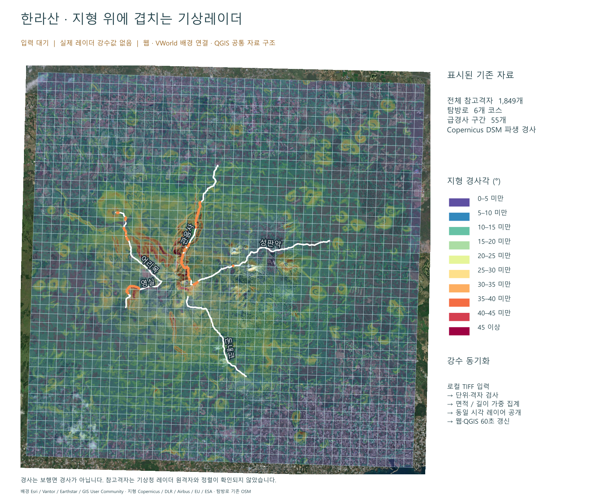

# Halla-GeoData

한라산 주변 **전체 500m 참고격자 1,849개**, Copernicus GLO-30 파생 경사도, 탐방로별 통계와 웹·VWorld 배경·QGIS 레이어를 모은 저장소입니다. CSV, SHP와 스타일, GeoTIFF, 지도 PNG, ZIP 및 생성 코드를 포함합니다.

**현재 제공 상태:** 경사도·탐방로 지도는 바로 사용할 수 있습니다. 기상청 수집기는 `.env`에 키를 넣고 실행하도록 추가했지만 실제 인증키/API 응답으로 시험하지 않았습니다. 수집 원자료를 강수 지도에 자동 변환하는 연결은 아직 완료되지 않았습니다. 실제 강수값이 없는 초기 화면은 `입력 대기`로 표시합니다.



## 바로 시작

1. 저장소 전체를 내려받습니다. QGIS 4.2.0의 Python/GDAL 환경에서 지도 기능을 검증했습니다. 다른 QGIS 버전은 별도 확인이 필요합니다.
2. **지도만 보기:** 루트의 `START_LOCAL.cmd` 실행 → 브라우저에서 `http://127.0.0.1:8765` 열기. 기상청 API 키가 없어도 기존 지형·탐방로를 봅니다.
3. **QGIS:** `outputs/hallasan_course_slope_v2/hallasan_course_slope.qgs`를 열면 색상·레이어명이 설정되어 있습니다. 레이더 동기화용 프로젝트는 `outputs/hallasan_radar_layers_v1/qgis/hallasan_live.qgs`입니다.
4. **키 설정:** `SETUP_ENV.cmd`를 한 번 실행하고 루트 `.env`의 아래 한 줄에 **기상청 API허브 원본 인증키**를 붙여 넣습니다. 다른 설정은 기본값으로 사용할 수 있습니다.

```dotenv
KMA_API_KEY=여기에_API허브_인증키
```

`.env`는 로컬 전용이며 Git에 포함되지 않습니다. GitHub에는 키가 비어 있는 `.env.example`을 제공합니다. 설치 프로그램은 기존 `.env`를 덮어쓰지 않습니다. data.go.kr의 `serviceKey`, VWorld 키와는 다른 설정입니다.

5. `CHECK_SETUP.cmd`로 키 입력 여부와 설정만 확인합니다. **이 명령은 API를 호출하지 않습니다.**
6. 실제 수집은 사용자가 `COLLECT_KMA_ONCE.cmd`를 실행할 때 시작합니다. `START_KMA_SYNC.cmd`는 실행 중인 콘솔에서 5분 간격으로 원자료를 수집합니다. PC/콘솔을 닫으면 중지하며 Windows 서비스나 AWS 예약 작업으로 설치하지 않습니다.

일반 Python 3.10 이상으로도 수집·설정 기능을 실행할 수 있습니다. 외부 패키지가 필요 없습니다.

```powershell
python kma_client.py setup
python kma_client.py check
python kma_client.py fetch
python kma_client.py fetch --time 202610140900  # KST, 5분 간격; 해당 자료의 제공 여부는 별도
python kma_client.py watch
```

## 파일 위치와 역할

| 경로 | 내용 |
|---|---|
| `outputs/hallasan_slope/` | 전체 참고격자 경사 통계, 10개 등급의 경사 폴리곤, DSM·경사·방향 래스터, QGIS·PNG |
| `outputs/hallasan_course_slope_v2/` | 코스별 CSV, 2,979개 픽셀 교차 선분, 55개 급경사 구간, SHP·QML·QGIS, 칼럼 사전과 상세 HTML |
| `outputs/hallasan_radar_layers_v1/` | 공통 레이어 웹지도, VWorld 배경 연결, GeoTIFF 집계기, QGIS 동기화 스크립트·테스트 |
| `outputs/aws_s3_guide/` | AWS S3 생성 순서 설명 PNG. 실제 AWS 콘솔 캡처가 아닌 안내 그림 |
| `outputs/*.zip` | 배포용 파일집 3개. 풀린 폴더와 함께 제공하며, 레이더 ZIP은 오프라인 지도 번들 |
| `work/*.py` | 범위 준비 → 지형 계산 → 코스 교차 → 지도·스타일 → 검증·패키징 코드 |
| `work/public_sources/` | 기존에 확보한 공개 DSM 타일, 배경 영상, 다운로드 출처·해시 |
| `inputs/reference/hallasan_course_cells.gpkg` | 기존 참고격자·OSM 탐방로 등 계산 입력 |
| `kma_client.py`, `.env.example` | 새 기상청 원자료 수집기와 설정 템플릿 |
| `runtime/kma/` | 수집 후 생기는 원자료·상태·해시. 로컬 전용, Git 제외 |
| `tests/test_kma_client.py` | 네트워크 없는 수집기 단위 테스트 |
| `FILE_MANIFEST.csv` | 공개 파일별 크기·SHA-256·분류 목록 |

다운로드: [전체 경사 SHP ZIP](outputs/hallasan_slope_QGIS_SHP.zip) · [코스 경사 QGIS ZIP](outputs/hallasan_course_slope_QGIS_v2.zip) · [레이더 3방식 지도 ZIP](outputs/hallasan_radar_3ways.zip)

## 경사도 계산 로직

원자료는 **Copernicus GLO-30 DSM**입니다. VWorld 화면의 경사도 분석값을 추출한 자료가 아닙니다. 1초각 DSM을 UTM 52N(EPSG:32652), 30m로 재투영하고 GDAL Horn 방식으로 경사각(°)을 계산했습니다. 분석 경계 바깥 버퍼를 포함해 경계 계산 영향을 줄였습니다.

- 전체 격자: 경사 픽셀과 참고격자의 실제 교차면적을 가중치로 통계 계산.
- 코스: 탐방로와 30m 픽셀의 교차 길이를 가중치로 평균 계산. 최대는 교차한 유효 픽셀의 최대 경사각.
- 급경사: 이 분석에서 정한 **20° 이상**을 연결한 선 구간. 공식 통제·위험 기준이 아닙니다.
- 이 값은 DSM 지형의 최대 경사이며 탐방로 진행방향의 실제 보행 경사가 아닙니다. 수목·구조물 영향이 포함될 수 있습니다.
- 6개 코스를 계산했습니다. 석굴암은 기존 탐방로 선형이 없어 CSV에 결측으로 남겼습니다. OSM 선형의 완전성·최신성은 미확인입니다.
- 1,849개 참고격자는 기존 가정 LCC 좌표계에서 생성되었으며 **공식 기상청 원격자와 정렬이 검증되지 않았습니다.** 영역은 한라산 주변으로 일부 해안을 포함하고 제주도 전체는 아닙니다.

코스 결과: [course_summary.csv](outputs/hallasan_course_slope_v2/course_summary.csv) · [steep_sections.csv](outputs/hallasan_course_slope_v2/steep_sections.csv) · [개요 지도](outputs/hallasan_course_slope_v2/maps/course_slope_overview.png)

## QGIS 레이어·칼럼·색상

SHP는 `.shp` 형상, `.dbf` 속성, `.shx` 인덱스, `.prj` 좌표계, `.cpg` 문자 인코딩이 함께 있어야 합니다. `.qml`은 색상·기호·칼럼 별칭을 저장하는 스타일이며 데이터 레이어를 추가하는 파일은 아닙니다. 폴더의 `.qgs`를 열면 여러 자료와 스타일을 한 번에 불러옵니다.

| 레이어 | 도형/자료 | 표시 기준 |
|---|---|---|
| `grid_slope_500m` | 참고격자 폴리곤 1,849개 | `mean_deg`로 평균 경사, `max_deg`로 최대 경사 |
| `slope_classes` | 경사 등급 폴리곤 27,501개 | `class_id` 및 등급별 QML |
| `course_summary` | 코스 선 6개 | 평균·최대 경사 및 급경사 길이 |
| `steep_sections` | 급경사 선 55개 | 코스별 연결된 20° 이상 구간 |
| `trail_slope_pieces` | 픽셀과 교차한 선 2,979개 | 개별 경사·길이, 세부 계산 확인 |
| `study_boundary`, `reference_park` | 경계 폴리곤 | 분석 범위·기존 공원 참고 경계 |
| `reference_trails`, `reference_labels` | 탐방로 선·지점 | 기존 선형·명칭 참고 |
| `dem_30m`, `slope_degrees_30m`, `aspect_degrees_30m` | 래스터 | DSM 고도(m), 경사각(°), 방향(°) |
| `satellite_background` | 영상 래스터 | Esri 배경 시각화 |

경사 스펙트럼은 0–5, 5–10, …, 40–45, 45° 이상입니다. 색상 순서: `#5e4fa2`, `#3288bd`, `#66c2a5`, `#abdda4`, `#e6f598`, `#fee08b`, `#fdae61`, `#f46d43`, `#d53e4f`, `#9e0142`. 자동 분위수 분류로 바꾸면 동일 색상의 의미가 달라지므로 비교할 때 등급 경계를 유지합니다.

정확한 필드명·의미·단위는 [전체 칼럼 사전](outputs/hallasan_course_slope_v2/metadata/all_layer_fields.csv), 레이어별 설명은 [layer_descriptions.json](outputs/hallasan_course_slope_v2/metadata/layer_descriptions.json), 조작법은 [START_HERE.html](outputs/hallasan_course_slope_v2/START_HERE.html)에 있습니다. HTML은 다운로드 후 브라우저에서 여세요. SHP 칼럼 이름은 길이 제한 때문에 축약되어 있습니다.

## 기상청 수집과 지도 반영의 현재 경계

```text
.env의 API허브 키
    → 사용자가 fetch/watch 실행
    → PCPH · MSK · acc=60 · unit=MM · ASCII 원자료
    → 형식/개수 검증, 해시, 실패 시 마지막 정상 원자료 유지
    → runtime/kma/raw/ 및 latest_raw.json
    → [미완료] 실제 표본의 좌표·시각·결측 검증과 누적강수 지도 입력기

검증된 물리량 강우강도 GeoTIFF(mm/h) + 메타데이터 JSON
    → 현재 processor.py 입력기
    → 격자 면적 가중 / 코스·급경사 구간 길이 가중 집계
    → 동일 frame_id의 GeoJSON·CSV·GeoTIFF
    → latest.json 공개 → 웹·QGIS 60초 갱신
```

기본 수집기는 공식 문서에 따라 PCPH의 **누적량 mm**를 명시적으로 요청합니다. 설정한 누적기간의 결과이며 순간 강우강도 mm/h가 아닙니다. 수집 시각은 KST 현재 시각에서 기본 20분 전, 5분 단위로 정합니다. 이는 발행 지연을 고려한 프로젝트 기본값이지 자료 제공 보장이 아닙니다. 인접한 60분 누적자료를 더하면 시간이 중복됩니다.

키만 입력하면 **수집 실행 설정**은 끝납니다. 계정의 레이더 활용신청 승인, 실제 API 제공 여부, 원격자 검증까지 자동으로 해결되지는 않습니다. 수집 원자료에 좌표를 추정해 붙이거나 mm를 mm/h로 바꾸어 기존 지도에 넣지 않습니다. 레이더 맵 변환을 끝내려면 다음이 필요합니다.

1. 정상 실응답과 관측시각·누적기간 확인.
2. 동일 상품의 공식 좌표 정보로 행·열 순서, CRS, 원점, 셀 중심/경계를 대조.
3. 음수 특수코드의 결측·무에코 의미를 상품별로 확정하고 유효 0과 구분.
4. 누적량용 필드·시간창·지도 범례를 구현하거나, 별도 검증한 강우강도 자료를 현재 입력기에 공급.

수집기는 인증정보를 URL 로그·응답 오류·저장 메타데이터에 기록하지 않으며 리다이렉트를 따라가지 않습니다. 실제 인증키나 KMA API 호출은 이번 구현·검증에 사용하지 않았습니다. [공식 레이더 API 문서](https://apihub.kma.go.kr/apiList.do?seqApi=5)를 기준으로 요청 인자를 구성했습니다(확인: 2026-10-14).

| 실패 상황 | 처리 및 확인 사항 |
|---|---|
| 키 없음 | 네트워크 호출 전에 종료; 루트 `.env` 확인 |
| HTTP 401/403 | 해당 요청은 재시도하지 않음; API허브 키·활용신청 권한 확인 |
| HTTP 429, 5xx, 시간초과·연결 실패 | 요청당 제한된 횟수만 재시도; watch는 설정 주기 후 다음 시도 |
| HTTP 200이지만 HTML/JSON 오류·깨진 격자 | 원자료로 저장하지 않음; 요청 시각·권한·제공 조건 확인 |
| 새 자료 실패 | 마지막 정상 원자료/기존 지도 유지; `runtime/kma/status.json`에 상태 기록 |

## 기존 강우강도 입력기

`outputs/hallasan_radar_layers_v1/input/radar.example.json`을 참고해 **검증된 단일 밴드 GeoTIFF**와 JSON을 `input/`에 넣습니다. 예제 파일은 자동 처리하지 않습니다. CRS, 단위, NoData 확인값이 참이어야 하며 시간에는 타임존이 있어야 합니다. 실제로 검증하지 않고 플래그를 바꾸면 안 됩니다.

래스터 원격자 폴리곤을 계산 기준 좌표계로 변환해 면적·길이 교차 가중 통계를 냅니다. 강수 정량 집계 때문에 원격자 값을 500m 참고격자에 단순 리샘플링하지 않습니다. 결측은 `null`, 무강수는 유효한 `0`으로 처리하며 유효 면적/길이 비율도 출력합니다. 선이 셀 경계와 겹치면 중복 길이를 제거합니다. 동일 관측시각·수정번호 충돌은 거부하고 늦게 도착한 자료가 최신 포인터를 과거로 돌리지 않게 합니다. 실패한 로컬 입력은 다음 주기에 재시도합니다.

VWorld 모드는 자체 웹지도에 VWorld 배경을 연결하는 기능입니다. VWorld 공개 포털에 레이어를 업로드하거나 3D 레이더를 생성하는 기능은 아닙니다. 키는 해당 화면에서 별도로 입력하며 메모리에만 유지합니다. 실제 VWorld 인증 타일 요청은 미검증입니다.

QGIS 콘솔에서 프로젝트를 연 뒤 다음 스크립트를 실행하면 60초마다 같은 프레임의 레이어를 갱신합니다.

```python
from pathlib import Path
exec((Path(QgsProject.instance().fileName()).parent / 'sync_layers.py').read_text(encoding='utf-8'))
```

SHP 자체에는 실시간 갱신 기능이 없습니다. 자세한 설명은 [공통 지도 안내](outputs/hallasan_radar_layers_v1/dist/guide.html)를 참고하세요.

## ArcGIS·AWS·출처

**ArcGIS World Imagery 서버는 기존 위성/항공 배경 영상을 얻는 데 사용했습니다.** 경사 계산은 Copernicus DSM, 강수는 별도 기상자료가 담당합니다. 현재 저장소의 기본 지도는 기존에 저장한 배경 영상을 읽으므로 실행할 때마다 ArcGIS를 요청하지 않습니다. 배경은 여러 시기의 모자이크이며 촬영일은 검증하지 않았습니다.

- [Esri World Imagery 서비스](https://services.arcgisonline.com/ArcGIS/rest/services/World_Imagery/MapServer): Esri, Vantor, Earthstar Geographics, GIS User Community.
- [Copernicus DEM 공개 AWS 자료](https://registry.opendata.aws/copernicus-dem/): 이 프로젝트에서 사용한 2021 배포 GLO-30 타일과 서비스 접근 방식은 Copernicus Browser와 다를 수 있습니다.
- 지형 출처: produced using Copernicus WorldDEM-30 © DLR e.V. 2010-2014 and © Airbus Defence and Space GmbH 2014-2018 provided under COPERNICUS by the European Union and ESA; all rights reserved.
- 탐방로 등 기존 참고벡터: © OpenStreetMap contributors, [ODbL/출처](https://www.openstreetmap.org/copyright).

AWS에는 공개 지형·지도 파일과 수집기를 나누어 배치하는 구조를 안내했습니다. 실제 사용자 AWS 계정에 버킷·서버를 생성하거나 배포하지 않았습니다. 공개 정적 배포에는 `outputs/hallasan_radar_layers_v1/dist/`만 사용하고 `.env`, `runtime/`은 올리지 않습니다. 운영 인증키는 Secrets Manager 등 서버의 비밀 저장소에 두고 프런트엔드에 주입하지 않습니다. 기존 [AWS 명령 예제](outputs/hallasan_course_slope_v2/metadata/aws_commands.txt)는 사용자가 버킷 이름·권한·비용을 확인한 뒤 실행하는 예제입니다.

외부 데이터의 권리는 원 제공자에게 있습니다. 저장소에 포함되었다고 별도의 무제한 이용허락이 생기지 않습니다. 출처·자료별 조건은 [DATA_SOURCES.md](DATA_SOURCES.md)에 정리했습니다.

## 재현 및 검증

수집기 테스트는 합성 문자열·가짜 HTTP 응답만 사용합니다.

```powershell
python -m unittest discover -s tests -v
```

GIS 통합 테스트는 QGIS Python에서 실행합니다.

```powershell
& 'C:\Program Files\QGIS 4.2.0\bin\python-qgis.bat' -X utf8 outputs/hallasan_radar_layers_v1/tests/test_pipeline.py
```

지형 전체 재계산은 QGIS Python으로 `work/prepare_slope_region.py` → `work/build_slope_data.py` → `work/render_slope_bundle.py` → `work/verify_slope_bundle.py` → `work/analyze_course_slope.py` → `work/render_course_slope.py` → `work/make_course_guide.py` → `work/verify_course_slope.py` 순서입니다. 기존 원자료가 포함되어 있어 다시 다운로드할 필요가 없습니다. `work/fetch_slope_sources.py`만 별도의 네트워크 다운로드 코드이며 자동 실행하지 않습니다. Windows 글꼴을 사용하는 렌더링 스크립트는 다른 OS에서 글꼴 경로 조정이 필요합니다.

`work/build_radar_workspace.py`는 정적 지도 자료를 다시 만들면서 초기 대기 상태를 기록합니다. 운영 중 수집자료가 있는 폴더에서 무심코 재실행하지 마세요. `work/package_radar_workspace.py`는 오프라인 ZIP과 검증 결과를 재생성합니다. 개인정보·인증키·실수집 자료·임시 테스트 폴더는 공개 파일집에 포함하지 않습니다.

실제 API 가용성·실응답 변환·AWS 배포·상시 운영 성능을 검증 완료로 주장하지 않습니다. 지형 및 레이더 시각화는 탐방 통제나 안전 판단을 대신하지 않습니다.
